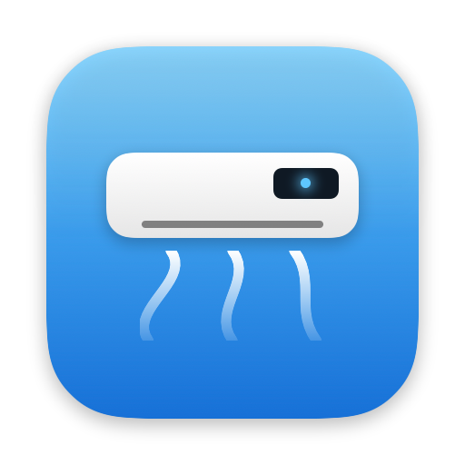
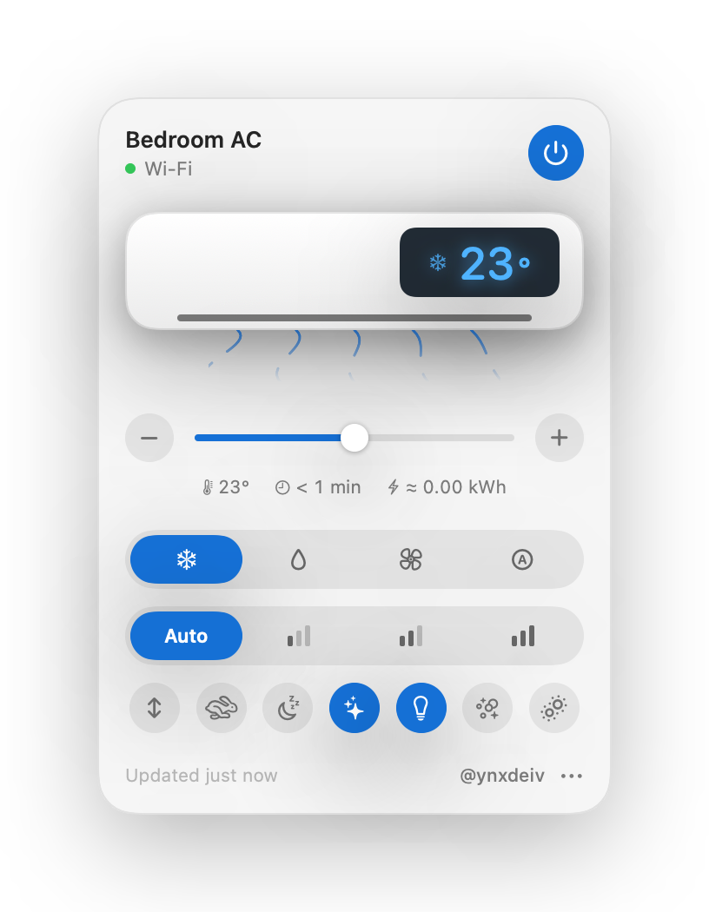
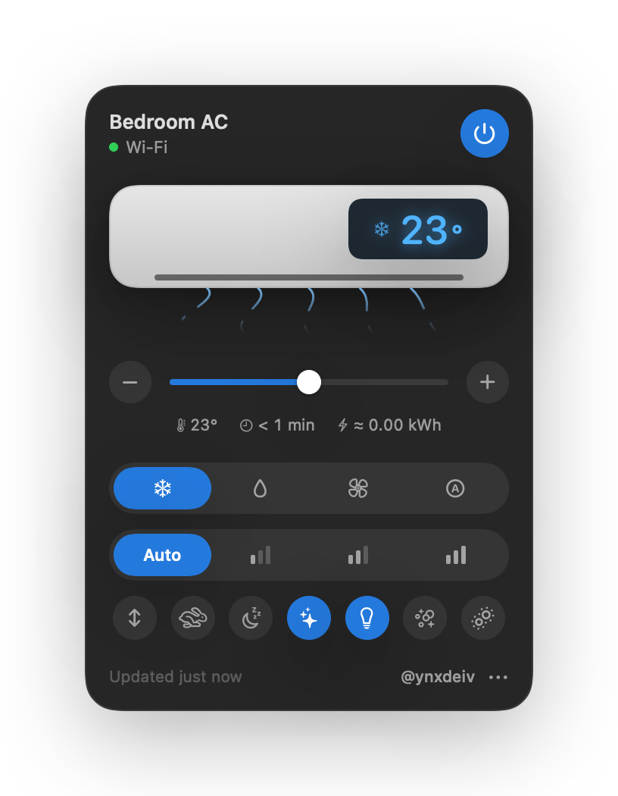
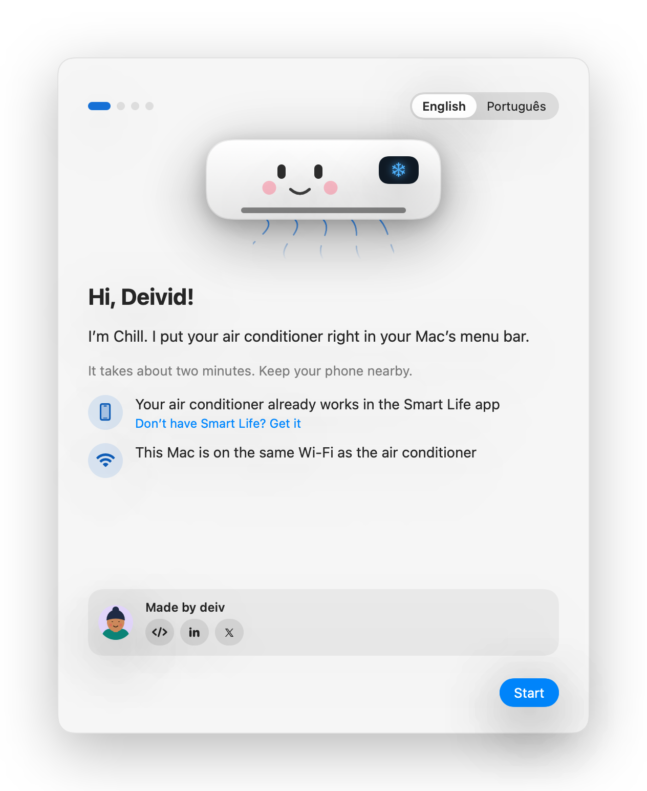
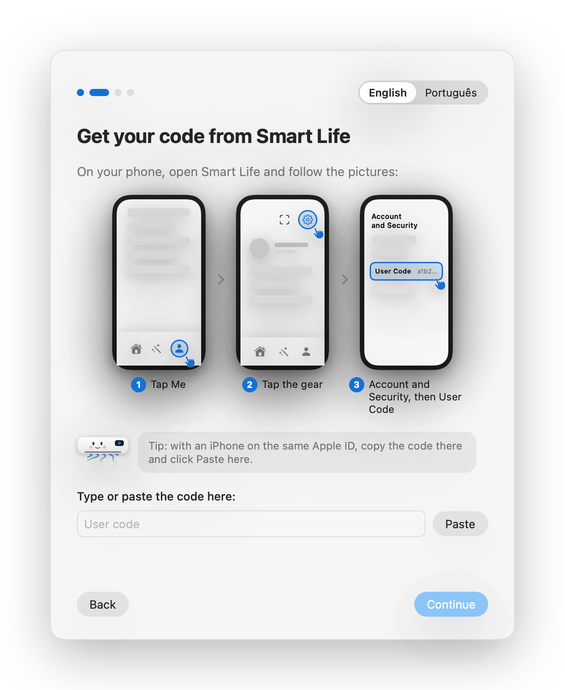
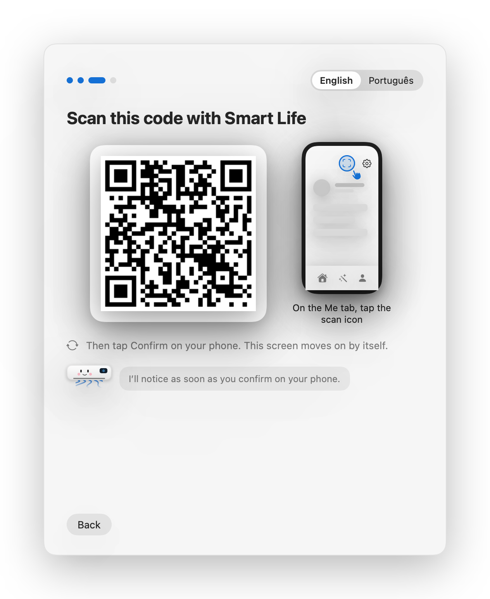

<p align="center">
  
</p>

<h1 align="center">Chillbar</h1>

<p align="center">
  <b>Your air conditioner, right in your Mac’s menu bar.</b><br>
  Turn it on, set the temperature and switch modes in one click — straight over your Wi-Fi, no cloud.
</p>

<p align="center">
  <a href="https://github.com/ynxdeiv/chillbar/releases/latest/download/Chillbar.dmg"><b>⬇️ Download for macOS</b></a> ·
  <a href="README.pt-BR.md">🇧🇷 Leia em português</a>
</p>

<p align="center">
  
  
</p>

## What it does

- **One-click control** from the menu bar: power, temperature, mode, fan speed, swing, turbo, sleep, IonAir, display and more — the same buttons as your remote.
- **Fast and private:** after setup, Chillbar talks to the air conditioner **directly on your Wi-Fi**. Commands are confirmed by the unit itself in about half a second.
- **Always honest:** shows *Sending…* until the air conditioner confirms, and warns you if it doesn’t.
- **Knows your model:** locks what your unit locks (for example, Auto mode keeps 25 °C on the Elgin Eco Inverter III).
- **Time on and estimated energy** use while it runs.
- **Liquid Glass** design on macOS 26, light and dark mode, **English and Portuguese**.

## Install

1. **[Download `Chillbar.dmg`](https://github.com/ynxdeiv/chillbar/releases/latest/download/Chillbar.dmg)**, open it and drag **Chillbar** to **Applications**.
2. Open Chillbar. Because it isn’t notarized by Apple yet, macOS will block the first launch:
   - Open **System Settings → Privacy & Security**, scroll down and click **Open Anyway** next to *Chillbar*.
   - Or, in Terminal: `xattr -dr com.apple.quarantine /Applications/Chillbar.app`
3. When macOS asks, **allow Local Network** access — that’s how Chillbar reaches your air conditioner.

Requires macOS 14 Sonoma or later (Liquid Glass on macOS 26).

## Set up in two minutes

You only need your phone with the **Smart Life** app:
[App Store](https://apps.apple.com/app/smart-life-smart-living/id1115101477) ·
[Google Play](https://play.google.com/store/apps/details?id=com.tuya.smartlife)

| | |
|---|---|
| **1. Add your air conditioner to Smart Life.** If it’s in another app (like *Elgin Smart*), remove it there first, then reset its Wi-Fi (Elgin: press **IONAIR 8×** on the remote) and add it in Smart Life. |  |
| **2. Copy your user code.** In Smart Life: **Me → ⚙ → Account and Security → User Code**. Paste it in Chillbar. |  |
| **3. Scan the QR code** with Smart Life (**Me →** scan icon) and tap **Confirm**. Chillbar finds the air conditioner on your Wi-Fi and you’re done. |  |

The setup window opens by itself the first time. To run it again: menu bar icon → **⋯ → Set Up Air Conditioner…**

## Does it work with my air conditioner?

Chillbar works with **Wi-Fi air conditioners built on the Tuya platform** that use the local **protocol 3.3** — the same platform behind the *Smart Life* and *Tuya Smart* apps and many brand apps.

| Status | Air conditioner |
|---|---|
| ✅ **Tested** | **Elgin Eco Inverter III Wi-Fi** — 45HJFI12C2WF (12,000 BTU/h, cool only), app *Elgin Smart*, Wi-Fi module TYAUX-J2 |
| 🟡 **Should work** | Other **Elgin** Wi-Fi splits controlled by the **Elgin Smart** app (Eco Inverter II/III with TYAUX-J or TYAUX-J2 modules) and **AUX-made** Tuya air conditioners with the same data points |
| 🟡 **Maybe** | Other Tuya air conditioners (category *Air conditioner* in Smart Life). The connection works, but buttons may need a [device profile](#add-your-model) |
| ❌ **Not yet** | Units using the **Elgin Air** / *AC Freedom* app (Broadlink module BLI206-P), Tuya devices on protocol 3.4/3.5, and infrared-only air conditioners |

**Quick check:** if your air conditioner works in the **Smart Life** app (or in a brand app that says *Powered by Tuya*), it’s very likely compatible. Tried another model? [Open an issue](https://github.com/ynxdeiv/chillbar/issues) and tell us — it helps everyone.

## How it works

- **Setup (once):** Chillbar uses Tuya’s official device-sharing SDK — the same QR login Home Assistant uses — to fetch your air conditioner’s local key. No Tuya developer account needed.
- **Every day:** Chillbar talks to the unit directly on your network (TCP 6668, discovery on UDP 6667). Nothing goes through Chillbar servers — there aren’t any.
- **Your key stays on your Mac,** in the Keychain. It’s never shown, logged or sent anywhere else.

> The QR login relies on Home Assistant’s public device-sharing registration, like other open-source tools. If Tuya ever restricts it, new setups would need a Tuya developer key; units you already set up keep working, because the key is saved on your Mac.

## Troubleshooting

| Problem | Fix |
|---|---|
| **“Offline”** | Make sure the Mac and the air conditioner are on the same Wi-Fi, and that **Local Network** is allowed in *System Settings → Privacy & Security → Local Network*. |
| **“The device didn’t confirm”** | The unit may be out of reach or that function may not exist on your model. Try again or open an issue with your model. |
| **Stopped working after re-pairing** | Re-pairing in Smart Life changes the key. Run setup again: **⋯ → Set Up Air Conditioner…** |
| **Keychain prompt after an update** | Click **Always Allow** (development builds are signed locally). |

## Build from source

Needs Swift 6 (Xcode 16+ or the Command Line Tools).

```bash
git clone https://github.com/ynxdeiv/chillbar.git
cd chillbar
scripts/test.sh        # run the tests
scripts/build-app.sh   # build/Chillbar.app
scripts/make-dmg.sh    # build/Chillbar-<version>.dmg
```

| Folder | What’s inside |
|---|---|
| `Sources/ACCore` | Air-conditioner model, mode rules, command validation, confirmation tracking |
| `Sources/ACTuya` | Tuya local protocol 3.3, network discovery, Smart Life QR login, device profiles |
| `Sources/ACApplication` | Controller and setup flow (no UI) |
| `Sources/ACInterface` | Menu bar popover, setup window, mascot and avatars (SwiftUI) |
| `Sources/ChillbarApp` | The app itself |

## Add your model

Each model is described by a small JSON file in [`Sources/ACTuya/Profiles`](Sources/ACTuya/Profiles): which data point is the power, the temperature, the modes, and what each mode allows. Copy the Elgin profile, adjust it for your unit and open a pull request — no Swift needed.

## Credits

Made by **deiv** — [GitHub](https://github.com/ynxdeiv) · [LinkedIn](https://www.linkedin.com/in/deivcst/) · [X](https://x.com/2003setembro)

Built on the shoulders of [tinytuya](https://github.com/jasonacox/tinytuya), Tuya’s [device-sharing SDK](https://github.com/tuya/tuya-device-sharing-sdk), [tuya-local](https://github.com/make-all/tuya-local) and [Home Assistant](https://www.home-assistant.io). See [third-party notices](THIRD_PARTY_NOTICES.md).

Chillbar is an independent project and is not affiliated with Elgin, Tuya, Smart Life or Apple. All trademarks belong to their owners.

## License

[Apache License 2.0](LICENSE)
